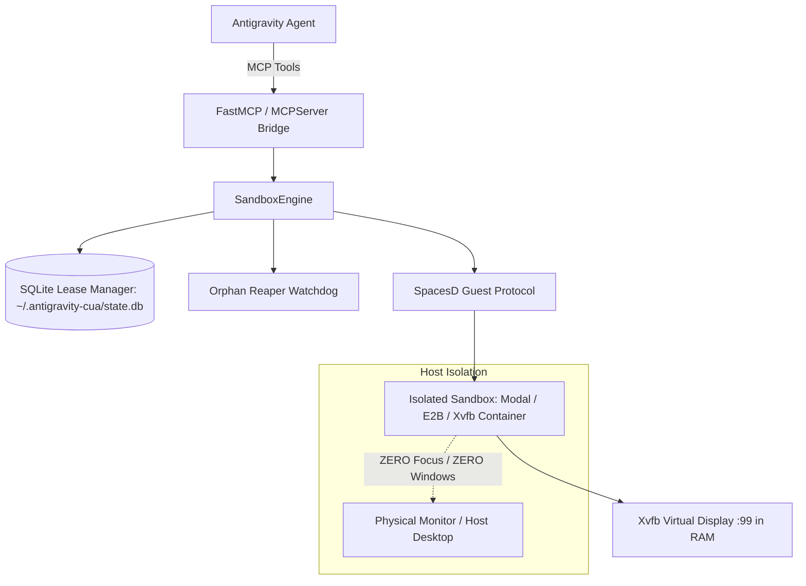

# Antigravity CUA Bridge (v0.2.0)

[](https://github.com/tanushgargjanuary-bot/antigravity-cua/actions/workflows/ci.yml)
[](LICENSE)
[](https://www.python.org/)

Production-grade integration connecting **Google Antigravity** agents to **CUA Spaces** (Modal, E2B, cloud micro-VMs, or headless Xvfb containers) via the Model Context Protocol (MCP).

---

## Architecture & Guarantees



### Invariants
1. **Zero Host Interference**: Under no circumstances does a window, browser, or GUI element ever render on your physical laptop screen. Keystrokes, mouse events, and clipboard operations are strictly directed to the virtual framebuffer (`:99`) in guest RAM.
2. **Persistent TTL Leases**: Sandbox states and expiration times are persisted in SQLite (`~/.antigravity-cua/state.db`). Active commands automatically renew the lease.
3. **Automated Resource Reaping**: Dangling or orphaned micro-VMs are automatically reclaimed by the watchdog reaper, preventing unexpected cloud costs.
4. **Real-Time PTY Streaming**: Low-latency terminal I/O over the guest SpacesD daemon.

---

## MCP Tools Reference

| MCP Tool | Description |
|---|---|
| `cua_spawn_sandbox` | Provision an isolated sandbox (image, TTL lease, cloud provider). |
| `cua_exec_isolated` | Execute bash commands inside guest container with lease extension. |
| `cua_capture_virtual_screen` | Capture PNG bytes of the virtual display from RAM without host display capture. |
| `cua_mouse_click` | Click at `(x, y)` (`left`, `right`, `middle`, `double`) on virtual display. |
| `cua_mouse_move` | Move pointer to `(x, y)` inside guest display. |
| `cua_keyboard_type` | Type text strings into active virtual window. |
| `cua_keyboard_key` | Send special keys (`Return`, `Tab`, `Escape`, `ctrl+c`). |
| `cua_mouse_scroll` | Scroll mouse wheel (`up` / `down`) on virtual display. |
| `cua_release_sandbox` | Tear down sandbox and release all allocated resources immediately. |
| `cua_reap_orphans` | Query SQLite for expired sandboxes and destroy them. |

---

## Installation & Setup

### 1. Install Package
```bash
pip install -e .
```

### 2. Configure Antigravity MCP (`~/.gemini/config/mcp_config.json`)
```json
{
  "mcpServers": {
    "cua-spaces": {
      "command": "python",
      "args": ["-m", "antigravity_cua.server"]
    }
  }
}
```

### 3. Provider Configuration (Optional)
Set environment variables to customize cloud providers:
```bash
export CUA_PROVIDER="modal"     # Options: cloud, modal, e2b, daytona, docker
export MODAL_TOKEN="your-token"
export E2B_API_KEY="your-key"
```

---

## Headless Container (Docker / Local)

To run fully isolated local sandboxes with Xvfb:
```bash
cd docker
docker compose up -d
```
This initializes a headless guest on virtual display `:99` with Fluxbox and xdotool in RAM.

---

## Testing

Run unit and integration tests:
```bash
PYTHONPATH=src python -m unittest discover -s tests -p "test_*.py" -v
```

---

## License
MIT
